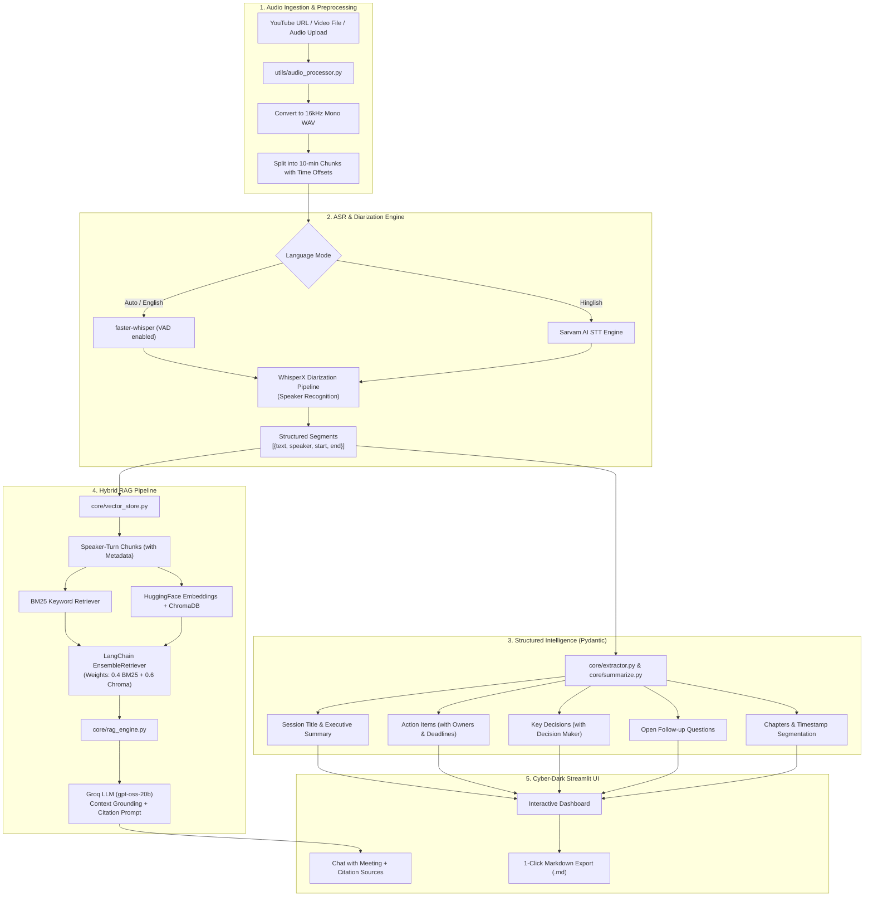
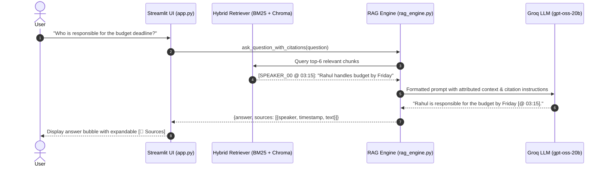

# 🎬 AI Video Assistant (Meeting Intelligence)

[](https://python.org)
[](https://streamlit.io)
[](https://langchain.com)
[](https://github.com/SYSTRAN/faster-whisper)
[](https://trychroma.com)
[](https://groq.com)

An enterprise-ready AI meeting intelligence assistant designed for **code-mixed (Hinglish / English)** and multi-speaker meetings. Converts YouTube videos or local audio/video uploads into structured notes, speaker-attributed action items, timestamped chapters, and an interactive **Hybrid RAG (BM25 + Dense Vector Search)** chat.

---

## 🌟 Key Highlights & Innovations

- ⚡ **4× Faster Transcription with VAD**: Powered by `faster-whisper` (CTranslate2 `int8` quantization) with Voice Activity Detection to skip silence.
- 🗣️ **Speaker Diarization**: Multi-speaker attribution (`SPEAKER_00`, `SPEAKER_01`) via WhisperX integration.
- 🇮🇳 **Code-Mixed Hinglish Support**: First-class support for Indian team meetings with Sarvam AI STT & translation fallback.
- 📦 **Type-Safe Pydantic Extraction**: Action items, key decisions, open questions, and chapters validated with Pydantic and self-healing LLM retry loops.
- 🧠 **Hybrid RAG Engine (BM25 + Chroma)**: Combines keyword search (for project names, numbers, acronyms) and semantic embeddings (`all-MiniLM-L6-v2`) via `EnsembleRetriever`.
- ⏱️ **Timestamp Citations**: RAG responses cite exact moments (`[@ 04:32]`), with expandable snippet sources in chat.
- 📄 **1-Click Markdown Export**: Download fully formatted executive meeting summaries and transcripts.

---

## 🏗️ System Architecture & Workflow



---

## 🔍 Retrieval & Citation Flow (RAG Deep Dive)



---

## 📁 Repository Structure

```text
AI-Video-Assistant/
├── app.py                     # Streamlit frontend with cyber-dark theme & chat
├── requirements.txt           # Python dependencies
├── .env.example               # Template for environment variables
├── packages.txt               # System-level dependencies (ffmpeg)
│
├── core/
│   ├── schemas.py             # Pydantic models (ActionItem, Decision, Chapter, etc.)
│   ├── transcriber.py         # faster-whisper + WhisperX diarization + Sarvam
│   ├── extractor.py           # Structured extraction with retry logic & speaker context
│   ├── summarize.py           # Map-reduce summarization & meeting title generator
│   ├── vector_store.py        # Speaker-turn chunking & BM25 + Chroma hybrid retriever
│   └── rag_engine.py          # Grounded RAG chain with timestamp citation formatting
│
└── utils/
    └── audio_processor.py     # yt-dlp downloader, FFmpeg converter, audio chunker
```

---

## 🛠️ Installation & Setup

### Prerequisites
1. **Python 3.10+**
2. **FFmpeg**:
   - **Windows**: `winget install Gyan.FFmpeg` or `choco install ffmpeg`
   - **macOS**: `brew install ffmpeg`
   - **Ubuntu/Debian**: `sudo apt install ffmpeg`

### 1. Clone the Repository
```bash
git clone https://github.com/ujjwalsingh1704/AI-Video-Assistant-.git
cd AI-Video-Assistant-
```

### 2. Set Up Virtual Environment
```bash
# Windows
python -m venv venv
.\venv\Scripts\activate

# macOS / Linux
python3 -m venv venv
source venv/bin/activate
```

### 3. Install Dependencies
```bash
pip install -r requirements.txt
```

### 4. Configure Environment Variables
Create a `.env` file in the project root:

```env
# Required for fast LLM inference & extraction
GROQ_API_KEY=your_groq_api_key

# Optional: Hugging Face Token for WhisperX speaker diarization
HF_TOKEN=your_huggingface_token

# Optional: Sarvam AI Key for Hinglish translation/STT
SARVAM_API_KEY=your_sarvam_api_key

# Model Configurations
WHISPER_MODEL=base
GROQ_MODEL=openai/gpt-oss-20b
SARVAM_STT_MODEL=saaras:v2.5
```

> **Note on Diarization**: To enable automatic speaker recognition, obtain a free Hugging Face token and accept the license on [pyannote/speaker-diarization-3.1](https://huggingface.co/pyannote/speaker-diarization-3.1). If `HF_TOKEN` is omitted, the app gracefully defaults to single-speaker mode (`SPEAKER_00`).

---

## 🚀 Running the Application

```bash
streamlit run app.py
```

1. Open your browser at `http://localhost:8501`.
2. Paste a YouTube URL or upload a local video/audio file (`.mp4`, `.mp3`, `.wav`, `.mkv`, `.webm`).
3. Select your language preference (`auto`, `english`, or `hinglish`).
4. Click **⚡ Analyse** to trigger the end-to-end pipeline.
5. Review the **Summary**, **Chapters**, **Action Items**, **Key Decisions**, and **Open Questions**.
6. Use the **💬 Chat with your Meeting** section to ask questions with grounded citations.
7. Click **📄 Export Markdown** to save the complete session report.

---

## 📊 Feature Comparison

| Feature | Vanilla Whisper Setup | This Assistant |
|---|---|---|
| **Transcription Speed** | Baseline | **~4× faster** (CTranslate2 + VAD) |
| **Silence Handling** | Transcribes background noise | **Auto-skipped** via Voice Activity Detection |
| **Speaker Identification** | None (Single text block) | **WhisperX Diarization** (`SPEAKER_00`, `SPEAKER_01`) |
| **Extraction Reliability** | Unstructured plain strings | **Pydantic Validation** with automated JSON retry |
| **Information Retrieval** | Pure Dense Vector Search | **Hybrid Search** (BM25 keyword + Chroma dense) |
| **Answer Grounding** | Generic LLM responses | **Exact Timestamp Citations** (`[@ MM:SS]`) |
| **Export Formats** | Copy-paste from UI | **Structured Markdown Export** |

---

## 🤝 Contributing

Contributions are welcome! Please open an issue or submit a pull request:
1. Fork the Project
2. Create your Feature Branch (`git checkout -b feature/AmazingFeature`)
3. Commit your Changes (`git commit -m 'Add some AmazingFeature'`)
4. Push to the Branch (`git push origin feature/AmazingFeature`)
5. Open a Pull Request

---

## 📄 License

Distributed under the MIT License. See `LICENSE` for more information.
